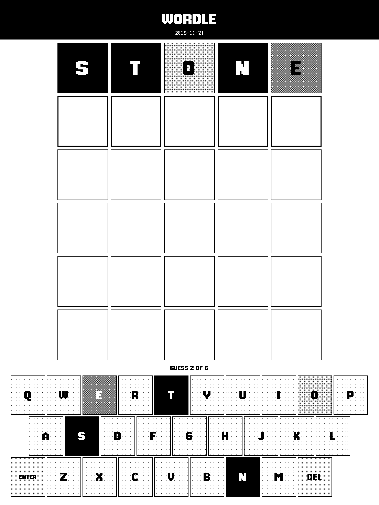

# Gri Wordle

A full-screen daily Wordle for [Grimoire](https://github.com/nebuff/grimoire-scribe) 2.3 and
later. It is a real installable app package, not a widget: it owns the display, has its own
on-screen keyboard, keeps its state across launches, and returns Home with the system gesture.



The answer comes from the public NYT Wordle endpoint:

```text
https://www.nytimes.com/svc/wordle/v2/YYYY-MM-DD.json
```

The app requests the current local date through Grimoire, fetches that day's JSON, and reads the
`solution` field. It never bundles a daily answer, so the puzzle changes with the date. If the
download fails, the board stays playable only after **Tap to retry** succeeds.

## Install

1. Open **Settings → Packages → Apps → Install from repository...**
2. Enter `nebuff/gri-wordle`.
3. Accept the trust page and install.
4. Open **Gri Wordle** from the home app row or **All apps**.

The app needs the `network:http` and `storage:app-local` capabilities. It hides the shared status
bar to give the board the whole display.

## Play

- Tap the on-screen letters to fill the current row.
- **ENTER** submits a five-letter word; **DEL** removes the last letter.
- Dark tiles are in the right place, mid-gray tiles are in the word elsewhere, and light tiles
  are not in the word. The keyboard marks remembered letters too.
- Guesses are checked against a public-domain five-letter dictionary. Six guesses, one word a day.
- The current puzzle, guesses, marks and result are stored in the app's own
  `state/runtime.bin`, so closing the app does not lose the day's game.
- The two-finger bottom-to-middle system swipe returns Home.

## Build

The app is a no_std Rust WebAssembly module. The WASM target and Python 3 are the only build
requirements.

```sh
rustup target add wasm32-unknown-unknown
make
```

`make` builds `target/wasm32-unknown-unknown/release/gri_wordle.wasm`, copies it to `app.wasm` at
the repository root, and updates `artifact.sha256` and `artifact.size` in `package.yaml`. Publish
both files, with a new version, for an update.

The source is deliberately small and has no allocator:

- `src/lib.rs` — app ABI, layout, drawing, input, game rules, state and HTTP polling
- `src/words.txt` — the readable public-domain five-letter dictionary source
- `src/words.bin` — the generated sorted, fixed-width dictionary the app binary-searches
- `tools/make_words.py` — regenerates `words.bin` when the dictionary source changes
- `tools/package.py` — writes the artifact digest and size into the manifest

`make check` builds without replacing the published artifact.

## Notes

This is an unofficial example and is not affiliated with The New York Times. The NYT endpoint is
used as the daily word source; the app does not reproduce the NYT interface. The dictionary is
from [`dwyl/english-words`](https://github.com/dwyl/english-words) under the Unlicense; see
`THIRD_PARTY_NOTICES.md`.
